# ParLevel — POS-Driven Inventory & Auto-Reordering for Small Restaurants

> **One-line pitch:** Connect your Square POS, map your recipes once, and ParLevel tracks every ingredient automatically, tells you exactly where money is leaking, and drafts your supplier orders for you.

*CS 452 Final Project · Initial planning document*

### TL;DR for classmates

Small restaurants track inventory with clipboards and spreadsheets, so they run out of things mid-shift, over-order and throw food away, and never know where their money goes. ParLevel listens to sales from the restaurant's Square POS and turns every burger sold into "−1 bun, −4 oz beef, −1 slice cheddar" in an append-only stock ledger. Weekly counts compare what *should* be on the shelf to what *is* there, which produces a variance report like "you lost $610 in chicken that sales don't explain." When stock runs low, it drafts the purchase order for you.

---

## Contents

1. [Problem & solution](#1-problem--solution)
2. [Goals](#2-goals)
3. [Target user & business case](#3-target-user--business-case)
4. [Initial ERD](#4-initial-erd)
5. [System design](#5-system-design)
6. [Key flows](#6-key-flows)
7. [UX sketches](#7-ux-sketches)
8. [MVP vs stretch scope](#8-mvp-vs-stretch-scope)
9. [Daily goals](#9-daily-goals)
10. [Decisions](#10-decisions)

---

## 1. Problem & solution

### The problem

Independent restaurants, cafés, and small franchise owners (1–5 locations) usually track inventory with paper count sheets, spreadsheets, or a manager eyeballing the walk-in. As a result they:

- **Run out** of key ingredients mid-shift, which costs them sales
- **Over-order**, so food spoils and money is wasted
- **Can't see where money leaks** to waste, over-portioning, theft, or comped meals
- **Lose hours every week** to manual counts and building supplier orders

Tools like MarketMan, MarginEdge, Restaurant365, and xtraCHEF exist, but they are often too expensive, too complex to set up, or built for larger operations.

### The solution: how it works

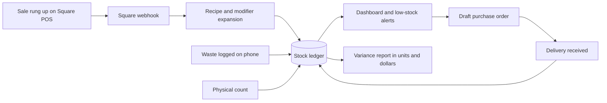

1. **Connect POS.** The owner connects Square with OAuth, and the menu is imported automatically through the Catalog API.
2. **Map recipes.** Each menu item maps to ingredients. For example, "Cheeseburger" = 1 bun + 4 oz beef + 1 slice cheddar + 0.5 oz sauce. Modifiers adjust usage ("extra cheese" +1 slice). Prep items such as sauces and dough are recipes too, and they expand down to raw ingredients when a sale is processed.
3. **Sales deplete inventory automatically.** Each completed order is expanded through its recipes into **sale** movements in the ledger. Refunds are stored as raw data but don't put stock back, because refunded food has usually already been made.
4. **Deliveries add stock.** Receiving a delivery writes **delivery** movements along with the real unit cost.
5. **Waste logging.** Staff log waste from a phone in a few taps (dropped, expired, burnt, spoiled, overproduced). A whole dish can be wasted too, and it expands through its recipe.
6. **Physical counts fix drift.** The first count sets each item's **opening balance**. After that, counted vs. expected becomes a **count_adjustment** movement and a line in the **variance report**.
7. **Reorder automatically.** Items that fall below their reorder point (counting what's already on order) produce a draft PO grouped by supplier, sized by par level and pack size.

**The headline feature is the variance report.** It shows owners exactly where money is leaking. Auto-reordering and time saved are the secondary benefits.

---

## 2. Goals

### Learning goals (CS 452)

| Goal | What I'll practice |
|---|---|
| **Relational data modeling** | A ~35-table normalized Postgres schema with real constraints (composite FKs, CHECKs, partial and exclusion constraints), and versioned migrations |
| **Ledger design** | An append-only event ledger instead of a mutable counter, with derived balances, as-of queries, and audit trails |
| **Webhooks & idempotency** | Signature verification, at-least-once delivery, duplicate and out-of-order events, unique constraints as the safety net |
| **Raw vs. derived data** | Storing external data as received, deriving movements from it with versioned recipes, and being able to reprocess |
| **Multi-tenant SQL** | Scoping every row by `organization_id` / `location_id` and enforcing it with composite foreign keys, possibly with Row-Level Security |
| **AI-assisted development** | Using Claude Code to build more in 30–40 hours than I could alone, and logging how |

### Product goals

- A restaurant can go from sign-up to "inventory tracking live" in **under an hour**
- Sales from Square deplete inventory **within a minute**, with **zero double-counting**
- A manager can count the walk-in or log waste **one-handed on a phone**
- The variance report answers **"how much money did I lose, and on what?"** in plain English
- A working **end-to-end demo** using the Square sandbox and a sales simulator

---

## 3. Target user & business case

**Customer (beachhead):** independent quick-service restaurants, cafés, and small franchise owners with **1–5 locations** that use **Square POS**, starting in **Utah County**.

**Value proposition:** "Know exactly where your food cost is going, without clipboards." Setup takes under an hour thanks to menu import and recipe templates, counting is mobile-first, and insights come in plain-English dollars.

### Competition

| | Built for | Setup effort | POS-driven depletion | Small-shop fit |
|---|---|---|---|---|
| **Spreadsheets / paper** | Anyone | Low | ✗ | Free but manual, no insight |
| **MarketMan** | Mid-size and multi-unit | High | ✓ | Powerful but heavy |
| **MarginEdge** | Mid-size, invoice-focused | Medium | Partial | Strong on invoices and costing |
| **Restaurant365** | Multi-unit groups, full accounting | Very high | ✓ | Overkill for 1–5 locations |
| **xtraCHEF (Toast)** | Toast restaurants | Medium | ✓ (Toast) | Tied to the Toast ecosystem |
| **ParLevel** | 1–5 location Square shops | **Low (< 1 hr)** | ✓ | **Simple, mobile-first, dollar insights** |

### Go-to-market

1. Visit local shops in person and recruit **1–3 friendly pilot owners**
2. Use pilot results ("found $X/month in waste") as case studies
3. Reach franchise owner networks, then list on the **Square App Marketplace**
4. **Expansion:** Clover → Toast (partner program) → multi-location transfers → supplier integrations → AI demand forecasting

### Key risks

| Risk | Mitigation |
|---|---|
| POS API access (Toast is gated) | Start with Square and Clover, which are open APIs; Toast later through its partner program |
| Messy recipe data | Recipe templates for common items, "unmapped items" queue, good-enough-is-fine defaults |
| Owner trust with sales data | Read-only POS scopes, clear data policy, encrypted tokens |
| Support load | Self-serve onboarding, sensible defaults, small pilot first |

---

## 4. Initial ERD

The schema is split into **three views of one ERD** so it stays readable on GitHub. Entities that appear in more than one view (like `ingredients` and `locations`) are the same table.

Conventions that apply to every table but are left out of the diagrams:

- Every table has `created_at timestamptz`, and mutable tables also have `updated_at`.
- Every business table carries `organization_id`. Foreign keys between tenant tables are **composite**, `(organization_id, x_id) → (organization_id, id)`, so a row can never point at another organization's data. Each referenced table has a `UNIQUE (organization_id, id)` to support this.
- "UK per org" in a comment means `UNIQUE (organization_id, column)`, not globally unique.
- Status and type columns are Postgres enums (Drizzle `pgEnum`).

### 4a. Tenancy, auth, units & suppliers

```mermaid
erDiagram
    organizations ||--o{ locations : has
    organizations ||--o{ memberships : has
    users ||--o{ memberships : holds
    users ||--o{ accounts : "signs in with"
    users ||--o{ sessions : has
    organizations ||--o| pos_connections : "connects via"
    organizations ||--o{ ingredients : catalogs
    units ||--o{ ingredients : "base unit of"
    units ||--o{ unit_conversions : converts
    ingredients ||--o{ unit_conversions : "specific to"
    locations ||--o{ inventory_items : stocks
    ingredients ||--o{ inventory_items : "stocked as"
    units ||--o{ inventory_items : "counted in"
    organizations ||--o{ suppliers : "buys from"
    suppliers ||--o{ supplier_items : sells
    ingredients ||--o{ supplier_items : "sold as"

    organizations {
        uuid id PK
        text name
    }
    locations {
        uuid id PK
        uuid organization_id FK
        text name
        text timezone "IANA, for local-day reports"
        text square_location_id "UK per org, null until linked"
    }
    users {
        uuid id PK
        text email UK
        text name
    }
    memberships {
        uuid id PK
        uuid organization_id FK
        uuid user_id FK
        text role "owner, manager, staff"
    }
    accounts {
        uuid id PK
        uuid user_id FK
        text provider "google"
        text provider_account_id
    }
    sessions {
        text session_token PK
        uuid user_id FK
        timestamptz expires
    }
    pos_connections {
        uuid id PK
        uuid organization_id FK "one per org"
        text provider "square"
        text merchant_id UK
        text access_token_enc "encrypted"
        text refresh_token_enc "encrypted"
        timestamptz expires_at
        timestamptz revoked_at
    }
    units {
        text code PK "g, oz, lb, ml, each, case"
        text dimension "mass, volume, count, package"
        numeric to_dimension_base "null for package units"
    }
    unit_conversions {
        uuid id PK
        uuid organization_id FK
        uuid ingredient_id FK
        text from_unit FK
        text to_unit FK
        numeric factor "1 case of buns = 96 each"
    }
    ingredients {
        uuid id PK
        uuid organization_id FK
        text name "UK per org"
        text category
        text base_unit FK
        boolean is_prepped "made by a prep recipe"
        timestamptz archived_at
    }
    inventory_items {
        uuid id PK
        uuid organization_id FK
        uuid location_id FK
        uuid ingredient_id FK
        text count_unit FK "unit staff count in"
        numeric par_level
        numeric reorder_point
        numeric on_hand "cache of ledger sum"
        numeric avg_cost "per base unit"
    }
    suppliers {
        uuid id PK
        uuid organization_id FK
        text name
        text email
        int lead_time_days
        timestamptz archived_at
    }
    supplier_items {
        uuid id PK
        uuid organization_id FK
        uuid supplier_id FK
        uuid ingredient_id FK
        text sku
        text pack_label "case of 6 cans"
        numeric pack_qty_base "base units per pack"
        numeric pack_price
        boolean is_preferred "one per ingredient"
        timestamptz archived_at
    }
```

`accounts` and `sessions` are the Auth.js adapter tables (database sessions). `verification_tokens` is only needed for email magic links, which are a stretch goal.

### 4b. Menu, recipes & raw POS data

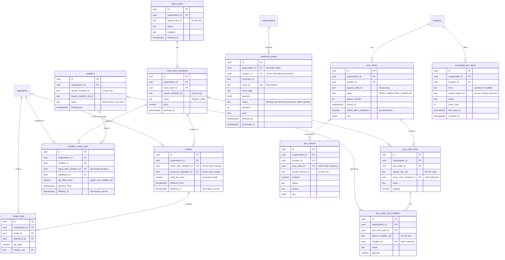

### 4c. Stock ledger & operations

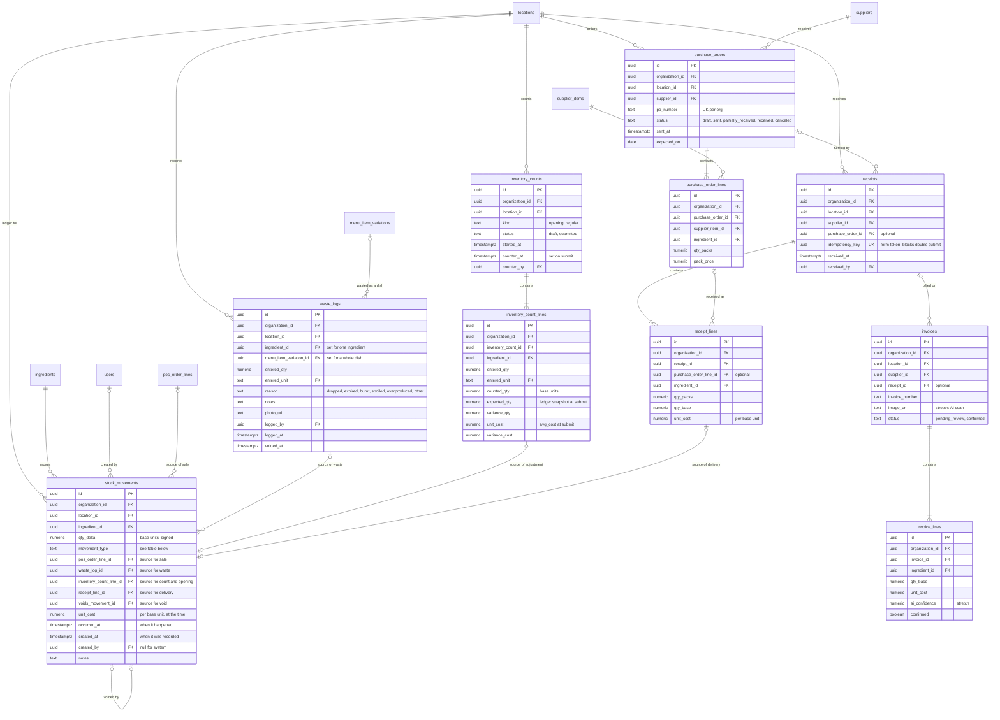

### Movement types

Each movement has **exactly one** source column set. This is an *exclusive arc*: real foreign keys plus `CHECK (num_nonnulls(pos_order_line_id, waste_log_id, inventory_count_line_id, receipt_line_id, voids_movement_id) = 1)`, instead of an untyped polymorphic `source_type` + `source_id`. Because each source has its own unique index, every way of writing stock is idempotent.

| `movement_type` | Sign | Source column | Idempotency (unique index) |
|---|---|---|---|
| `opening_balance` | ± | `inventory_count_line_id` (count with `kind = opening`) | `(inventory_count_line_id)` |
| `sale` | − | `pos_order_line_id` | `(pos_order_line_id, ingredient_id)` |
| `waste` | − | `waste_log_id` | `(waste_log_id, ingredient_id)` |
| `count_adjustment` | ± | `inventory_count_line_id` | `(inventory_count_line_id)` |
| `delivery` | + | `receipt_line_id` | `(receipt_line_id)` |
| `void` | opposite of the voided row | `voids_movement_id` | `(voids_movement_id)` |
| `prep_in`, `prep_out`, `transfer_in`, `transfer_out` | | *stretch:* add a source column when built | |

A per-type `CHECK` ties each `movement_type` to its source column and its sign. A void cannot target another void.

### Key design decisions

- **Ledger, not a counter.** Inventory is an **append-only `stock_movements` ledger**. On-hand = `SUM(qty_delta)`, cached in `inventory_items.on_hand` for fast reads.
  - The cache is updated in the same transaction as the insert, with an atomic `SET on_hand = on_hand + delta`, and only for rows the insert actually created (`INSERT ... ON CONFLICT DO NOTHING RETURNING`).
  - A nightly reconciliation query compares the cache to the ledger sum and logs any drift.
  - Append-only is **enforced by the database**: a trigger rejects `UPDATE` and `DELETE` on `stock_movements`.
  - Mistakes are fixed with a `void` movement (which references the bad row) plus a new correct entry. Old rows are never edited.
- **Two timestamps.** `occurred_at` is when it physically happened (for a sale, the order's `closed_at`). `created_at` is when the row was written. As-of queries use `occurred_at`, and `created_at` lets the system detect data that arrived late (see flow 6b).
- **Base units + `NUMERIC`.** Every quantity is stored in the ingredient's **base unit** (oz, each, ml) as `NUMERIC`, never float, so rounding never silently drifts inventory.
  - `units.to_dimension_base` handles generic conversions within a dimension (lb → oz).
  - `unit_conversions` holds only ingredient-specific conversions: across dimensions (1 cup of flour = 4.25 oz) or packages (1 case of buns = 96 each). Package units like `case` have no generic factor.
  - Counts and waste store what the person typed (`entered_qty`, `entered_unit`) along with the converted base quantity.
- **Idempotency.**
  - Square delivers webhooks *at least once* and possibly out of order. `webhook_events.event_id` is **UNIQUE**, so duplicates are dropped on insert.
  - Each movement source has its own unique index (table above), so reprocessing an order, re-submitting a count, or double-tapping "Receive" can never double-count. Usage from the base recipe and from modifiers is summed per ingredient *before* insert so it fits the sale index.
  - Receipts also carry a client-generated `idempotency_key`.
- **Raw vs. derived.** `webhook_events`, `pos_orders` / `pos_order_lines` / `pos_order_line_modifiers`, and `pos_refunds` keep Square data **as received**. `stock_movements` are **derived** from them.
  - Recipes are **versioned** (`effective_from` / `effective_to`). Editing a recipe closes the current version and inserts a new one, so any past sale can be re-derived with the recipe that was in effect at its `closed_at`.
  - An exclusion constraint (`btree_gist`) prevents overlapping versions for the same variation.
  - A variation's first recipe version is effective from `-infinity`.
- **Sub-recipes expand at sale time.** Prepped ingredients (sauce, dough) are not tracked as stock in the MVP. When a sale uses one, the expansion recursively follows its prep recipe (scaled by `yield_qty_base`) down to raw ingredients. A recursive CTE checks for cycles when a recipe is saved. When prep batches (`prep_in` / `prep_out`) ship as a stretch goal, stocked prep items will stop expanding.
- **Modifier precedence.** If a modifier has any lines scoped to the sold variation, only those apply. Otherwise its generic lines (`menu_item_variation_id` null) apply. Usage = `qty_delta_base × modifier quantity × line quantity`.
- **Unmapped items are surfaced, not ignored.** A sale of a variation or modifier with no recipe is still stored, upserted into `unmapped_pos_items`, and shown on the dashboard. When it gets mapped, the manager can backfill sale movements for those lines. Backfill only covers sales **after the location's last submitted count**, so submitted variance reports never change.
- **Refunds don't restock.** A refunded dish was usually already made, so putting its ingredients back would hide real usage. `refund.created` events are stored raw in `pos_refunds`, and inventory does not change. Restocking itemized returns (retail items) is a stretch goal.
- **Cost method: weighted average cost** *(judgment call)*.
  - Each delivery updates `avg_cost = (on_hand × avg_cost + received × unit_cost) / (on_hand + received)`.
  - If `on_hand ≤ 0` before the delivery (common, since sales are often recorded before the delivery is), `avg_cost = unit_cost` instead.
  - The opening count seeds `avg_cost` from the preferred supplier's `pack_price / pack_qty_base`.
  - Every movement stores `unit_cost` (the receipt cost for deliveries, the current `avg_cost` otherwise), so dollar figures in old reports stay stable and history can be recomputed if the method changes.
  - FIFO lot tracking would be more precise but far more complex.
- **Tenancy.** Every business row carries `organization_id`, plus `location_id` where relevant. Composite foreign keys make cross-tenant references impossible at the database level. All queries go through a data-access layer that requires the current org. Postgres **Row-Level Security** is a stretch hardening step.

### Constraints & indexes

**Uniqueness**

- `memberships (organization_id, user_id)`
- `inventory_items (location_id, ingredient_id)`
- `ingredients (organization_id, name)`
- `supplier_items (ingredient_id) WHERE is_preferred`
- `recipe_lines (recipe_id, ingredient_id)`
- `modifier_recipe_lines (modifier_id, menu_item_variation_id, ingredient_id, effective_from)` with `NULLS NOT DISTINCT`
- `pos_order_lines (pos_order_id, square_line_uid)` and `pos_order_line_modifiers (pos_order_line_id, square_modifier_uid)`, which the upserts depend on
- `unmapped_pos_items (location_id, kind, square_object_id)`
- `inventory_count_lines (inventory_count_id, ingredient_id)`
- `purchase_orders (location_id, supplier_id) WHERE status = 'draft'`: one open draft per supplier
- `inventory_counts (location_id) WHERE kind = 'opening'`: one opening count per location

**Checks**

- `recipes`: exactly one of `menu_item_variation_id` / `produces_ingredient_id` is set, and `yield_qty_base > 0` for prep recipes
- `waste_logs`: exactly one of `ingredient_id` / `menu_item_variation_id` is set, and `entered_qty > 0`
- `stock_movements`: exclusive arc, plus the sign and source column for each type
- Quantities, pack sizes, and prices are `≥ 0` wherever a sign isn't meaningful

**Exclusion**

- No overlapping `tstzrange(effective_from, effective_to)` per `recipes.menu_item_variation_id` and per `recipes.produces_ingredient_id`

**Indexes** (beyond PKs, uniques, and an index on every FK column)

- `stock_movements (location_id, ingredient_id, occurred_at)`: as-of on-hand and period sums for the variance report
- `stock_movements (organization_id, movement_type, occurred_at)`: waste and usage reports
- `webhook_events (received_at) WHERE status IN ('pending', 'failed')`: the queue, claimed with `FOR UPDATE SKIP LOCKED`
- `pos_orders (location_id, closed_at)`
- `unmapped_pos_items (location_id) WHERE resolved_at IS NULL`

---

## 5. System design

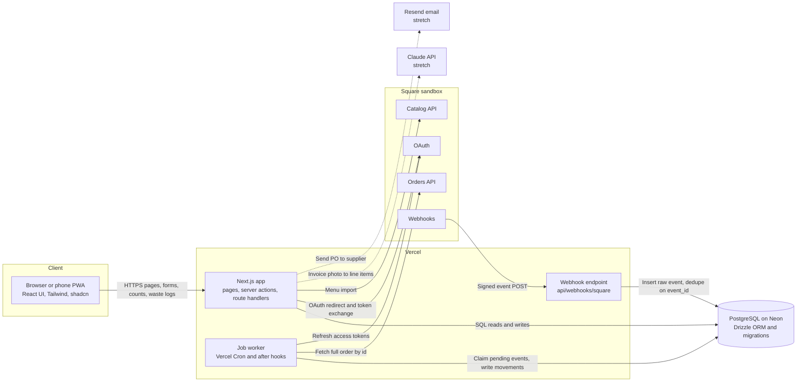

| Piece | Choice | Why *(alternatives)* |
|---|---|---|
| Frontend | **Next.js (App Router) + TypeScript + Tailwind + shadcn/ui**, responsive PWA | One codebase for desktop and phone *(alt: separate React Native app, too much for 40 hrs)* |
| Backend | **Next.js route handlers + server actions** | One deployable app *(alt: separate Express/Fastify API)* |
| Database | **PostgreSQL on Neon** | Highly relational data, and the class focus is modeling. Neon has free branching for dev *(alt: Supabase)* |
| ORM | **Drizzle** *(judgment call)* | SQL-first, TypeScript types, plain SQL migrations I can read and grade myself on *(alt: Prisma)* |
| Auth | **Auth.js with Google sign-in, database sessions** *(judgment call)* | Users live in *my* Postgres alongside `memberships`. Google avoids needing an email sender, and database sessions avoid the JWT-only credentials provider *(alt: Clerk, faster but external user store; magic links, need Resend)* |
| Webhooks | Verify `x-square-hmacsha256-signature`, store, return 200 fast | Square retries slow or failed responses. The signature covers the exact notification URL, so it needs a **stable HTTPS URL** (the production Vercel domain or a fixed tunnel domain), not a changing preview URL |
| Background work | `webhook_events.status` as the queue (`FOR UPDATE SKIP LOCKED`) + Next.js `after()` + **Vercel Cron** sweeper | No extra infra *(alt: Inngest, QStash)* |
| POS | **Square sandbox**: OAuth, Catalog, Orders, webhooks (`order.created`, `order.updated`, `refund.created`, `catalog.version.updated`) | Free, open API. One connection per organization (Square merchant). Square locations map to `locations.square_location_id` |
| Testing | **Vitest** against a Neon branch | A handful of ledger tests that back the "zero double-counting" claim |
| AI (stretch) | **Claude API** | Invoice photo → line items, natural-language questions |
| Email (stretch) | **Resend** | Send POs to suppliers, magic-link sign-in |
| Hosting | **Vercel + Neon** | Free tiers, zero-ops |

> **Note:** Square's order webhooks carry only the order id, state, and version, not the line items. The worker calls the **Orders API** to fetch the full order before expanding it. Merchant-level events such as `catalog.version.updated` have no location, so events are routed by `merchant_id` first. Events for unknown merchants or locations are marked `ignored`.

### Roles

| Action | Owner | Manager | Staff |
|---|:---:|:---:|:---:|
| Org settings, Square connection, invite users | ✓ | | |
| Ingredients, recipes, suppliers, par levels | ✓ | ✓ | |
| Log waste, enter count quantities, receive deliveries | ✓ | ✓ | ✓ |
| Submit counts, view variance and dollar figures | ✓ | ✓ | |
| Edit and send POs, void movements | ✓ | ✓ | |

---

## 6. Key flows

### (a) Order webhook → inventory depletion

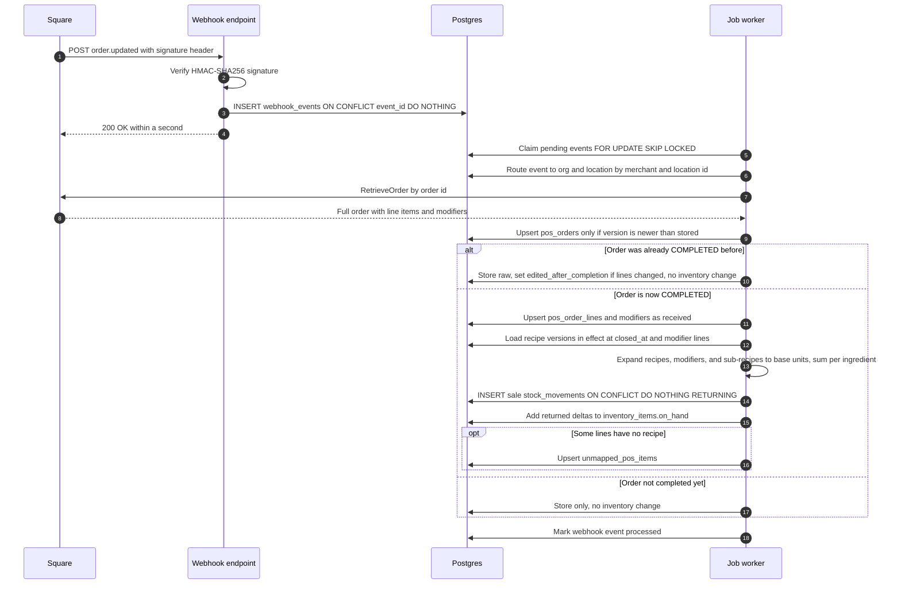

Sale movements use `occurred_at = closed_at` and `unit_cost` = the item's current `avg_cost`. The simulator builds Square-shaped order JSON and calls the **same** processing function, so demo data exercises the real code path.

### (b) Physical count → variance

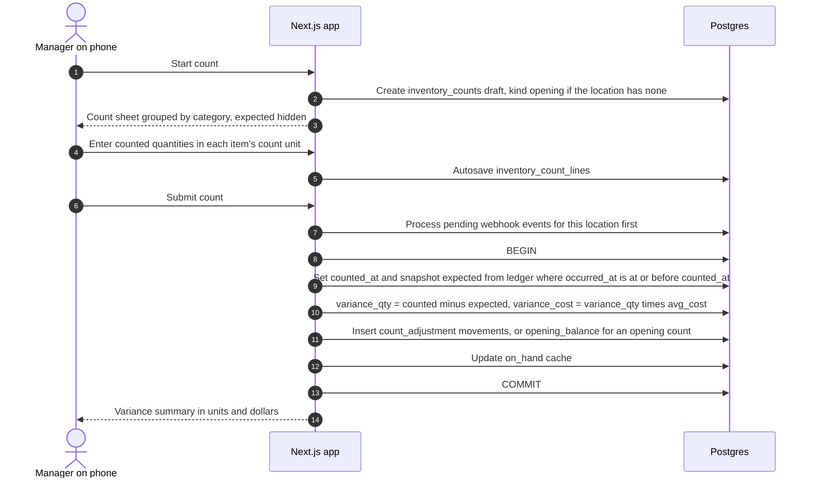

- **Partial counts:** only the items that were counted get lines and adjustments. Uncounted items are left alone.
- **Opening count:** the first count at a location writes `opening_balance` movements and is **left out of the variance report**. Without it, the first report would show the entire stock as "found."
- **Late-arriving sales (known limitation):** draining the queue before the snapshot handles the normal case. If a sale that closed before `counted_at` still arrives after submit, the variance for that item is off by that sale. The report flags these rows (`occurred_at ≤ counted_at < created_at`) so the discrepancy is explained, not hidden.

**Variance report definition.** For each ingredient, over the period between the previous submitted count (or the opening count) and this one:

| Column | Meaning |
|---|---|
| Starting on-hand | Ledger balance right after the previous count |
| Deliveries | Σ `delivery` movements |
| Theoretical usage | −Σ `sale` movements (what recipes say should have been used) |
| Logged waste | −Σ `waste` movements, net of voids |
| Expected | Starting + deliveries − theoretical − waste (= ledger as of `counted_at`) |
| Counted | What the manager counted |
| **Unexplained variance** | Counted − expected, in units and $ (`× unit_cost` at submit) |
| Actual usage | Starting + deliveries − counted |

Rows are sorted by unexplained $ loss, and the report also shows variance as a percentage of theoretical usage.

### (c) Low stock → draft PO → receive

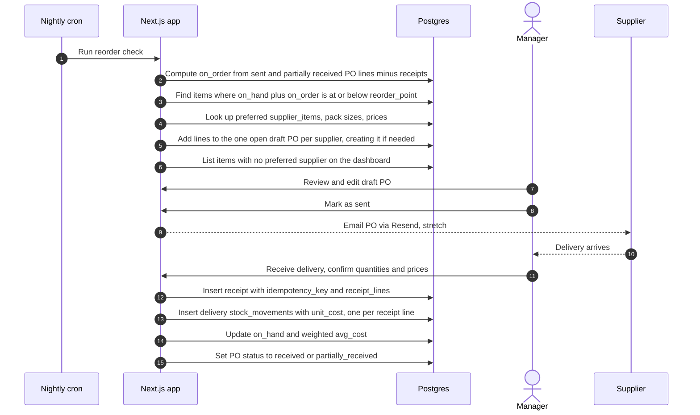

**Reorder math:** `on_order = Σ(ordered packs × pack_qty_base) − Σ(received qty_base)` over open POs. `need = par_level − on_hand − on_order` → `order_packs = ceil(need / pack_qty_base)`. The cron only adds items that aren't already on the draft, so it never overwrites manual edits. The draft is always editable before sending.

**Receiving** can happen with or without a PO. Partial deliveries are simply multiple receipts against the same PO. A PO is `received` once every line's received quantity meets the ordered quantity, or when the manager closes it short. Invoices (stretch) attach to receipts and never write stock themselves, so a delivery can't be counted twice.

---

## 7. UX sketches

Rough, grayscale, low-fidelity sketches. They capture layout and content, not final design. Count and waste logging are designed **mobile-first** because they happen in the walk-in, not at a desk.

### Dashboard
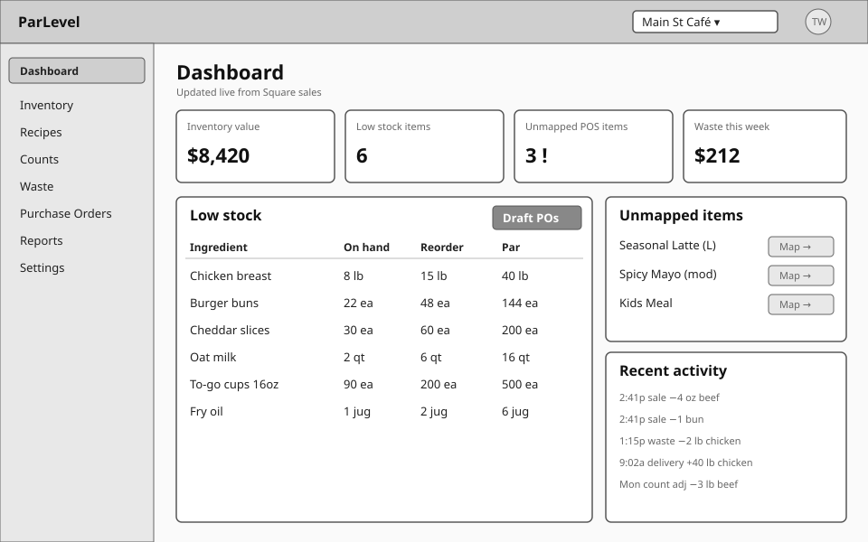

### Recipe mapping
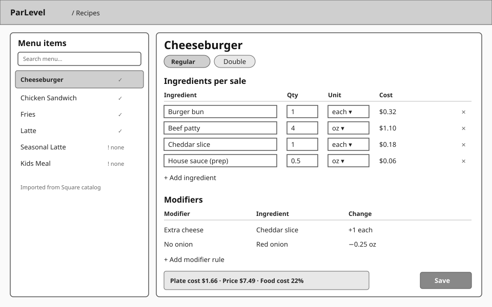

### Physical count (mobile) · Waste log (mobile)

  
  &nbsp;&nbsp;
  

### Variance report
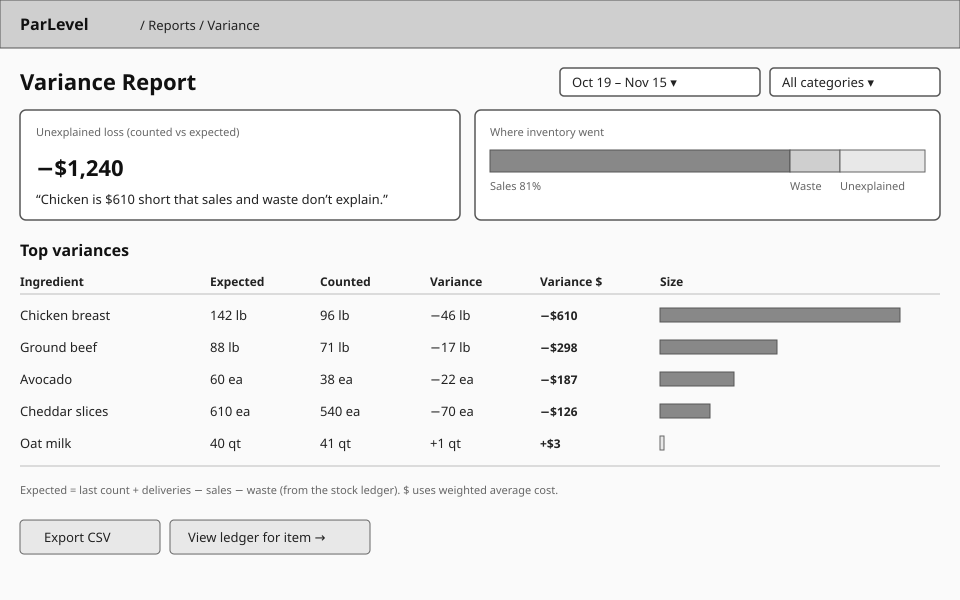

### Purchase order

---

## 8. MVP vs stretch scope

### ✅ MVP (must finish by end of class)

1. Auth (Google sign-in) + one organization and location, with owner/manager/staff roles
2. Square sandbox connection (OAuth) + menu import (Catalog API)
3. Ingredient, unit, and supplier management
4. Recipe mapping UI with versioned recipes, modifiers, and sub-recipe expansion
5. Webhook ingestion → idempotent processing → sale movements in the ledger. Refunds stored raw (no restock)
6. Inventory dashboard: on-hand, low stock, unmapped items (with backfill), items with no supplier, edited-after-completion orders
7. Waste logging (mobile-friendly), by ingredient or whole dish, with voids
8. Opening count + physical count flow + variance report (units and $)
9. Low-stock detection (on-order aware) → auto-drafted PO grouped by supplier; receipts write delivery movements
10. Seed script + **sales simulator** (creates sandbox orders, or fake local orders through the same processing path) so the demo works without a real restaurant
11. Ledger tests: webhook replay, double-submitted receipt, concurrent sale processing, void, opening count, and avg cost with negative on-hand

### 🌱 Stretch (only if ahead of schedule)

- AI invoice scanning (photo → line items with Claude, user confirms)
- Emailing POs to suppliers and magic-link sign-in (Resend)
- Natural-language questions ("what did I waste most last week?")
- Usage forecasting for smarter par levels
- Multi-location + transfers between locations
- Prep batch production (`prep_out` raw ingredients → `prep_in` prepped item)
- Storage areas (count by walk-in, dry storage, line)
- Restocking itemized returns
- Postgres Row-Level Security
- Correcting movements for Square orders edited after completion (diff order versions)

---

## 9. Daily goals

> ✅ **End-of-class date confirmed:** the last day of class is **Thursday, Dec 10, 2026**.

Rest days: Sundays and Thanksgiving (Thu Nov 26). Light days: Wed Nov 25 and Fri Nov 27. The risky parts (Square OAuth, webhooks, schema) come in the first week.

| Date | Goal | Est. hours | Done |
|---|---|---:|:---:|
| Thu Nov 19 | Planning: proposal, ERD, system design, flows, UX sketches, schedule; plan review and gap fixes | 2 | ☐ |
| Fri Nov 20 | Check the course rubric for required final deliverables; scaffold Next.js + TS + Tailwind + shadcn; create Neon DB; set up Drizzle + Vitest; deploy hello-world to Vercel | 2.5 | ☐ |
| Sat Nov 21 | Schema v1 + first migrations (tenancy with composite FKs, units, ingredients, inventory_items, stock_movements with exclusive arc, CHECKs, and append-only trigger, suppliers); seed units | 3 | ☐ |
| Sun Nov 22 | *Rest* | 0 | — |
| Mon Nov 23 | Auth.js (Google, database sessions) + org/location onboarding + roles; Square sandbox app; OAuth connect + encrypted token storage | 2.5 | ☐ |
| Tue Nov 24 | Catalog import → menu items, variations, modifiers; stable webhook URL; webhook endpoint with signature check → `webhook_events` | 2.5 | ☐ |
| Wed Nov 25 | *Light:* job worker claims events → fetch order → upsert `pos_orders` / lines (idempotent, version-checked); confirm sandbox orders reach COMPLETED | 1 | ☐ |
| Thu Nov 26 | *Thanksgiving: rest* | 0 | — |
| Fri Nov 27 | *Light:* ingredient, unit conversion, and supplier CRUD screens | 1 | ☐ |
| Sat Nov 28 | Recipe mapping UI (versioned, with modifiers); recipe + sub-recipe expansion → sale movements | 3 | ☐ |
| Sun Nov 29 | *Rest* | 0 | — |
| Mon Nov 30 | Unmapped items + backfill; raw refunds; inventory dashboard (on-hand, low stock, unmapped, flags) | 2.5 | ☐ |
| Tue Dec 1 | Waste logging (mobile, ingredient or dish, voids) → waste movements; sales simulator through the shared processing path | 2.5 | ☐ |
| Wed Dec 2 | Physical count flow (mobile), opening count, queue drain on submit → count movements | 2 | ☐ |
| Thu Dec 3 | Variance report (units and $) with weighted average cost | 2 | ☐ |
| Fri Dec 4 | Reorder check (on-order aware, one draft per supplier) → auto-drafted POs | 2 | ☐ |
| Sat Dec 5 | PO review + receipts → delivery movements and avg cost update | 2.5 | ☐ |
| Sun Dec 6 | *Rest* | 0 | — |
| Mon Dec 7 | **Buffer:** ledger tests, end-to-end demo run, bug fixes; stretch goal if ahead | 2 | ☐ |
| Tue Dec 8 | **Buffer:** UI polish, demo seed data (weeks of history with injected loss), README, final report draft | 2 | ☐ |
| Wed Dec 9 | Final presentation prep; finalize project log | 1.5 | ☐ |
| Thu Dec 10 | Present / submit final report | 1 | ☐ |
| **Total** | | **37.5** | |

---

## 10. Decisions

All of the questions from the initial plan are settled for now. Since this is the planning phase, any of them can be revisited once building starts. Rows 11–23 came from a review of the plan on Nov 19.

| # | Question | Decision | Why |
|---|---|---|---|
| 1 | Name | **ParLevel** | Final |
| 2 | End-of-class date | **Thu Dec 10, 2026** | Confirmed |
| 3 | Auth provider | **Auth.js with Google sign-in and database sessions** | Users live in my Postgres alongside `memberships`, which is better for the data model. Google needs no email sender. Magic links are stretch |
| 4 | ORM | **Drizzle** | SQL-first, readable migrations |
| 5 | Database host | **Neon** | Plain Postgres with free branching; photos (stretch) can go to blob storage later |
| 6 | Completed order edited later | **MVP: don't change inventory; flag it** | A newer version of a completed order is stored as raw data, its lines stay frozen, and `pos_orders.edited_after_completion` is set and shown on the dashboard. Diffing versions into correcting movements is a stretch goal |
| 7 | Expected qty during a count | **As of submit time** | One consistent timestamp (`counted_at`), simple to explain. Best practice is to count between shifts |
| 8 | Blind counts | **Yes, hide expected while counting** | More honest numbers, which is the point of the variance report |
| 9 | Demo data | **Both** | A local fake-order generator builds weeks of history quickly, and a few real sandbox orders prove the webhook path end to end |
| 10 | Pilot | **Yes, try to show it to one local shop owner** before the final presentation | Nice to have, not a dependency for the MVP |
| 11 | Starting inventory | **The first count is an opening count** that writes `opening_balance` movements and is excluded from variance | Otherwise the first variance report shows the whole stock as "found" |
| 12 | Refunds | **Store raw, don't restock** | Refunded food was usually already made. Restocking would hide real usage. Itemized restock is stretch |
| 13 | Prepped ingredients in the MVP | **Expand sub-recipes to raw ingredients at sale time** | Prep batches are stretch, so prepped items would otherwise go negative forever |
| 14 | Recipe changes | **Versioned recipes** (`effective_from` / `effective_to`) | Keeps movements reproducible from raw data, as principle 4 requires |
| 15 | Mapping an item that already sold | **Optional backfill, only for sales after the last submitted count** | Fixes current on-hand without rewriting submitted variance reports |
| 16 | Sales that arrive after a count | **Drain the location's queue before the snapshot. Flag any that still arrive late** | Handles the normal case simply. The rare leftover is shown, not hidden |
| 17 | Movement source links | **Exclusive arc** (one FK column per source + CHECK) | Real referential integrity and a unique index per source, instead of an unchecked polymorphic id |
| 18 | Receiving | **`receipts` / `receipt_lines` are the only source of delivery movements** | Idempotent receiving, multiple partial deliveries, and invoices can't double-count |
| 19 | Fixing mistakes | **`void` movement referencing the bad row, then a new correct entry** | Keeps the ledger append-only, which a trigger enforces |
| 20 | Square connection level | **One connection per organization (merchant)**; locations map via `square_location_id` | The catalog and webhooks are merchant-level in Square |
| 21 | "Comped" waste reason | **Removed** | Comps are rung up in Square, so they're already depleted as sales |
| 22 | Storage areas | **Not in MVP** | Counts cover the whole location. Areas are stretch |
| 23 | Average cost when on-hand ≤ 0 | **Reset to the delivery's unit cost** | The weighted formula breaks (or divides by zero) when on-hand isn't positive |
