# ParLevel — POS-Driven Inventory & Auto-Reordering for Small Restaurants

> **One-line pitch:** Connect your Square POS, map your recipes once, and ParLevel tracks every ingredient automatically, tells you exactly where money is leaking, and drafts your supplier orders for you.

*CS 452 Final Project · Initial planning document*

### TL;DR for classmates

Small restaurants track inventory with clipboards and spreadsheets, so they run out of things mid-shift, over-order and throw food away, and never know where their money goes. ParLevel listens to sales from the restaurant's Square POS and turns every burger sold into "−1 bun, −4 oz beef, −1 slice cheddar" in an append-only stock ledger. Weekly counts compare what *should* be on the shelf to what *is* there, which produces a variance report like "you lost $610 in chicken that sales don't explain." When stock runs low, it drafts the purchase order for you.

---

## Contents

1. [Problem & solution](#1-problem--solution)
2. [Goals](#2-goals)
3. [Target user & business case](#3-target-user--business-case)
4. [Initial ERD](#4-initial-erd)
5. [System design](#5-system-design)
6. [Key flows](#6-key-flows)
7. [UX sketches](#7-ux-sketches)
8. [MVP vs stretch scope](#8-mvp-vs-stretch-scope)
9. [Daily goals](#9-daily-goals)
10. [Decisions](#10-decisions)

---

## 1. Problem & solution

### The problem

Independent restaurants, cafés, and small franchise owners (1–5 locations) usually track inventory with paper count sheets, spreadsheets, or a manager eyeballing the walk-in. As a result they:

- **Run out** of key ingredients mid-shift, which costs them sales
- **Over-order**, so food spoils and money is wasted
- **Can't see where money leaks** to waste, over-portioning, theft, or comped meals
- **Lose hours every week** to manual counts and building supplier orders

Tools like MarketMan, MarginEdge, Restaurant365, and xtraCHEF exist, but they are often too expensive, too complex to set up, or built for larger operations.

### The solution: how it works

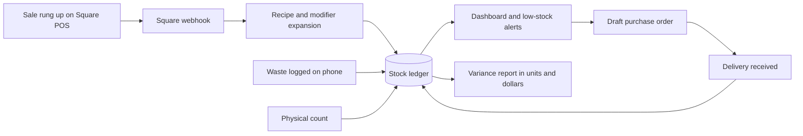

1. **Connect POS.** The owner connects Square with OAuth, and the menu is imported automatically through the Catalog API.
2. **Map recipes.** Each menu item maps to ingredients. For example, "Cheeseburger" = 1 bun + 4 oz beef + 1 slice cheddar + 0.5 oz sauce. Modifiers adjust usage ("extra cheese" +1 slice). Prep items such as sauces and dough are recipes too.
3. **Sales deplete inventory automatically.** Each completed order is expanded through its recipes into **sale** movements in the ledger. Refunds write reversing movements.
4. **Deliveries add stock.** Receiving a purchase order writes **delivery** movements along with the real unit cost.
5. **Waste logging.** Staff log waste from a phone in a few taps (dropped, expired, burnt, comped).
6. **Physical counts fix drift.** Counted vs. expected becomes a **count_adjustment** movement and a line in the **variance report**.
7. **Reorder automatically.** Items that fall below their reorder point produce a draft PO grouped by supplier, sized by par level and pack size.

**The headline feature is the variance report.** It shows owners exactly where money is leaking. Auto-reordering and time saved are the secondary benefits.

---

## 2. Goals

### Learning goals (CS 452)

| Goal | What I'll practice |
|---|---|
| **Relational data modeling** | A ~30-table normalized Postgres schema with real constraints, FKs, and versioned migrations |
| **Ledger design** | An append-only event ledger instead of a mutable counter, with derived balances and audit trails |
| **Webhooks & idempotency** | Signature verification, at-least-once delivery, duplicate and out-of-order events, unique constraints as the safety net |
| **Raw vs. derived data** | Storing external data as received, deriving movements from it, and being able to reprocess |
| **Multi-tenant SQL** | Scoping every row by `organization_id` / `location_id`, possibly with Row-Level Security |
| **AI-assisted development** | Using Claude Code to build more in 30–40 hours than I could alone, and logging how |

### Product goals

- A restaurant can go from sign-up to "inventory tracking live" in **under an hour**
- Sales from Square deplete inventory **within a minute**, with **zero double-counting**
- A manager can count the walk-in or log waste **one-handed on a phone**
- The variance report answers **"how much money did I lose, and on what?"** in plain English
- A working **end-to-end demo** using the Square sandbox and a sales simulator

---

## 3. Target user & business case

**Customer (beachhead):** independent quick-service restaurants, cafés, and small franchise owners with **1–5 locations** that use **Square POS**, starting in **Utah County**.

**Value proposition:** "Know exactly where your food cost is going, without clipboards." Setup takes under an hour thanks to menu import and recipe templates, counting is mobile-first, and insights come in plain-English dollars.

### Competition

| | Built for | Setup effort | POS-driven depletion | Small-shop fit |
|---|---|---|---|---|
| **Spreadsheets / paper** | Anyone | Low | ✗ | Free but manual, no insight |
| **MarketMan** | Mid-size and multi-unit | High | ✓ | Powerful but heavy |
| **MarginEdge** | Mid-size, invoice-focused | Medium | Partial | Strong on invoices and costing |
| **Restaurant365** | Multi-unit groups, full accounting | Very high | ✓ | Overkill for 1–5 locations |
| **xtraCHEF (Toast)** | Toast restaurants | Medium | ✓ (Toast) | Tied to the Toast ecosystem |
| **ParLevel** | 1–5 location Square shops | **Low (< 1 hr)** | ✓ | **Simple, mobile-first, dollar insights** |

### Go-to-market

1. Visit local shops in person and recruit **1–3 friendly pilot owners**
2. Use pilot results ("found $X/month in waste") as case studies
3. Reach franchise owner networks, then list on the **Square App Marketplace**
4. **Expansion:** Clover → Toast (partner program) → multi-location transfers → supplier integrations → AI demand forecasting

### Key risks

| Risk | Mitigation |
|---|---|
| POS API access (Toast is gated) | Start with Square and Clover, which are open APIs; Toast later through its partner program |
| Messy recipe data | Recipe templates for common items, "unmapped items" queue, good-enough-is-fine defaults |
| Owner trust with sales data | Read-only POS scopes, clear data policy, encrypted tokens |
| Support load | Self-serve onboarding, sensible defaults, small pilot first |

---

## 4. Initial ERD

The schema is split into **three views of one ERD** so it stays readable on GitHub. Entities that appear in more than one view (like `ingredients` and `locations`) are the same table. **Dotted lines** are *polymorphic* links: `stock_movements.source_type` + `source_id` point at the row that caused the movement, which is not a real FK.

### 4a. Tenancy, units, catalog & suppliers

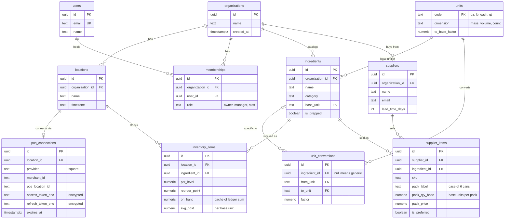

### 4b. Menu, recipes & raw POS data

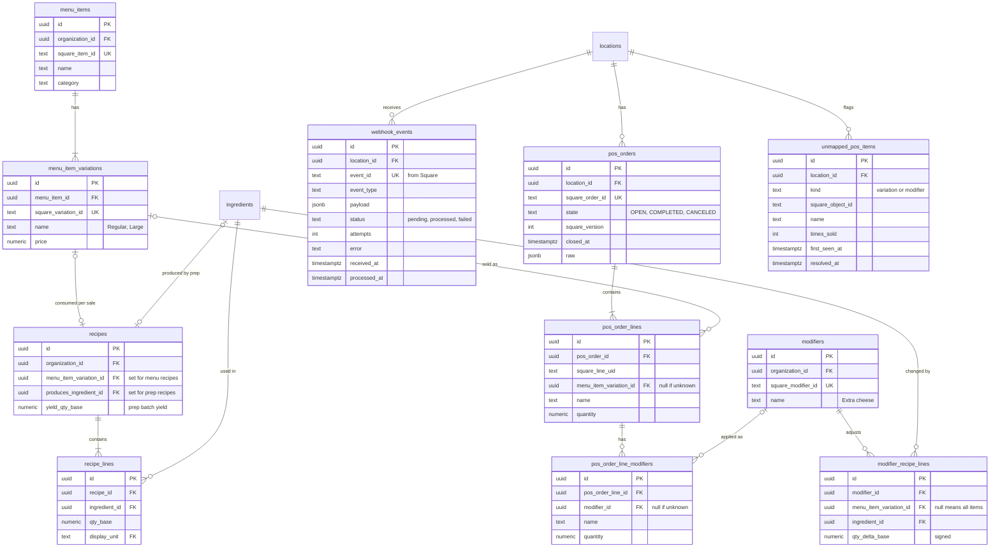

### 4c. Stock ledger & operations

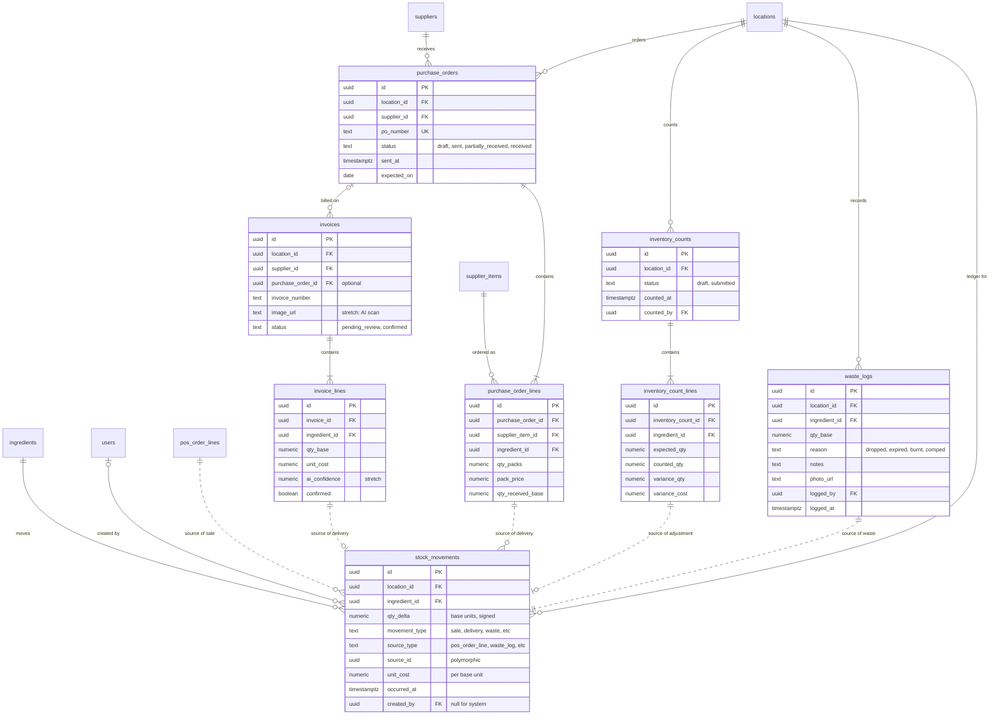

### Key design decisions

- **Ledger, not a counter.** Inventory is an **append-only `stock_movements` ledger** with movement types `sale`, `delivery`, `waste`, `count_adjustment`, `prep_in`, `prep_out`, `refund_reversal`, and `transfer`. On-hand = `SUM(qty_delta)`, cached in `inventory_items.on_hand` for fast reads (updated in the same transaction as the insert). Mistakes are fixed with new movements, never by editing old ones. This gives a full audit trail, and it is what makes the variance report possible.
- **Base units + `NUMERIC`.** Every quantity is stored in the ingredient's **base unit** (oz, each, ml) as `NUMERIC`, never float, so rounding never silently drifts inventory. `units` handles generic conversions (lb → oz), and `unit_conversions` handles ingredient-specific ones (1 "case" of buns = 96 each, 1 cup of flour = 4.25 oz).
- **Idempotency.** Square delivers webhooks *at least once* and possibly out of order. `webhook_events.event_id` is **UNIQUE**, so duplicates are dropped on insert. Sale and refund movements also have a **partial unique index on `(source_type, source_id, ingredient_id)`**, so reprocessing an order can never double-deplete. Usage from the base recipe and from modifiers is summed per ingredient *before* insert so it fits that rule. Deliveries are excluded from the index so partial receiving works.
- **Raw vs. derived.** `webhook_events` and `pos_orders` / `pos_order_lines` keep Square data **as received**. `stock_movements` are **derived** from them, so if a recipe mapping was wrong I can write corrections from the raw data.
- **Unmapped items are surfaced, not ignored.** A sale of a variation or modifier with no recipe still gets stored, and it is upserted into `unmapped_pos_items` and shown on the dashboard.
- **Cost method: weighted average cost** *(judgment call)*. Each delivery updates `avg_cost = (on_hand × avg_cost + received × unit_cost) / (on_hand + received)`. It is one number per item, smooths price swings, and is the norm for food-cost reporting. FIFO lot tracking would be more precise but far more complex. `unit_cost` is stored on every movement, so history can be recomputed if this changes.
- **Tenancy.** Every business row is scoped by `organization_id` and, where relevant, `location_id`. All queries go through a data-access layer that requires the current org. Postgres **Row-Level Security** is a stretch hardening step.

---

## 5. System design

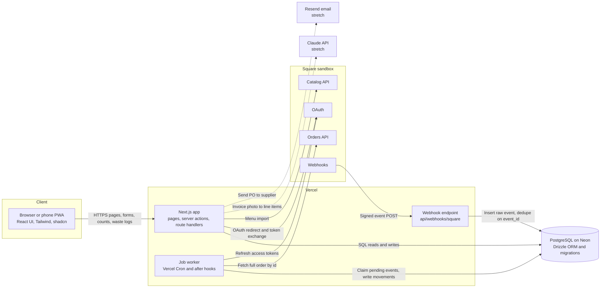

| Piece | Choice | Why *(alternatives)* |
|---|---|---|
| Frontend | **Next.js (App Router) + TypeScript + Tailwind + shadcn/ui**, responsive PWA | One codebase for desktop and phone *(alt: separate React Native app, too much for 40 hrs)* |
| Backend | **Next.js route handlers + server actions** | One deployable app *(alt: separate Express/Fastify API)* |
| Database | **PostgreSQL on Neon** | Highly relational data, and the class focus is modeling. Neon has free branching for dev *(alt: Supabase)* |
| ORM | **Drizzle** *(judgment call)* | SQL-first, TypeScript types, plain SQL migrations I can read and grade myself on *(alt: Prisma)* |
| Auth | **Auth.js** *(judgment call)* | Users live in *my* Postgres alongside `memberships` *(alt: Clerk, faster but external user store)* |
| Webhooks | Verify `x-square-hmacsha256-signature`, store, return 200 fast | Square retries slow or failed responses |
| Background work | `webhook_events.status` as the queue + Next.js `after()` + **Vercel Cron** sweeper | No extra infra *(alt: Inngest, QStash)* |
| POS | **Square sandbox**: OAuth, Catalog, Orders, webhooks (`order.created`, `order.updated`, `payment.updated`, `refund.created`, `catalog.version.updated`) | Free, open API |
| AI (stretch) | **Claude API** | Invoice photo → line items, natural-language questions |
| Email (stretch) | **Resend** | Send POs to suppliers |
| Hosting | **Vercel + Neon** | Free tiers, zero-ops |

> **Note:** Square's order webhooks carry only the order id, state, and version, not the line items. The worker calls the **Orders API** to fetch the full order before expanding it.

---

## 6. Key flows

### (a) Order webhook → inventory depletion

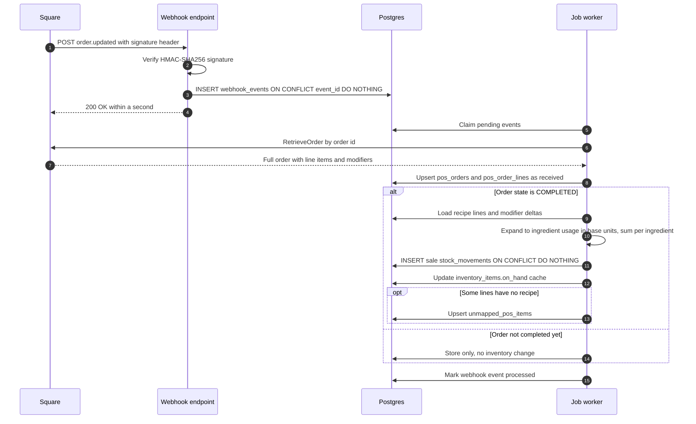

### (b) Physical count → variance

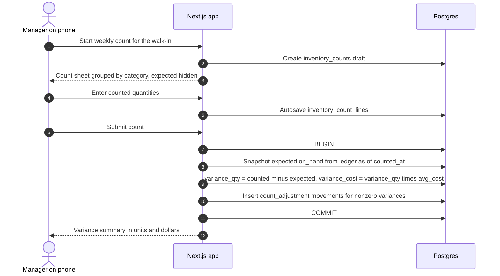

### (c) Low stock → draft PO → receive

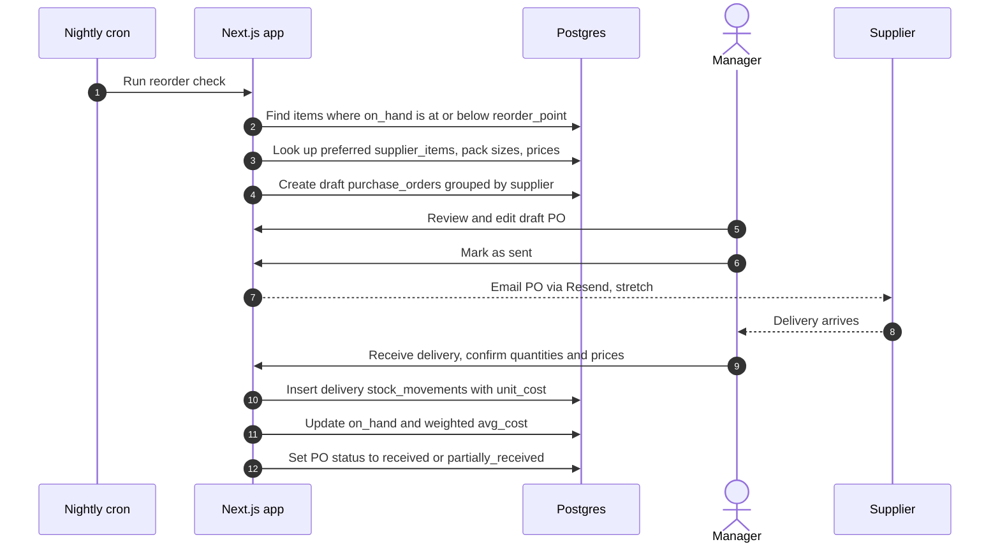

**Reorder math:** `need = par_level − on_hand` → `order_packs = ceil(need / pack_qty_base)`. The draft is always editable before sending.

---

## 7. UX sketches

Rough, grayscale, low-fidelity sketches. They capture layout and content, not final design. Count and waste logging are designed **mobile-first** because they happen in the walk-in, not at a desk.

### Dashboard

### Recipe mapping

### Physical count (mobile) · Waste log (mobile)

  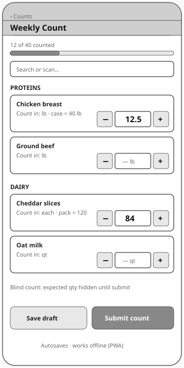
  &nbsp;&nbsp;
  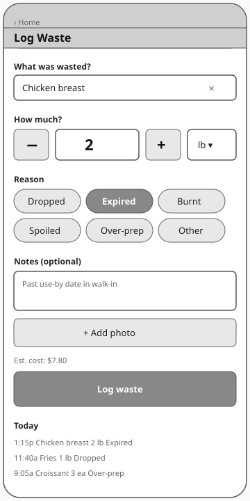

### Variance report

### Purchase order
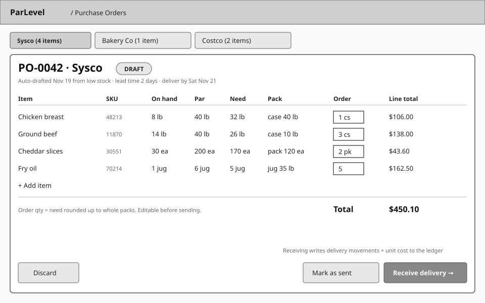

---

## 8. MVP vs stretch scope

### ✅ MVP (must finish by end of class)

1. Auth + one organization and location
2. Square sandbox connection (OAuth) + menu import (Catalog API)
3. Ingredient, unit, and supplier management
4. Recipe mapping UI, including modifiers
5. Webhook ingestion → idempotent processing → sale movements in the ledger (+ refund reversals)
6. Inventory dashboard: on-hand, low stock, unmapped items
7. Waste logging (mobile-friendly)
8. Physical count flow + variance report (units and $)
9. Low-stock detection → auto-drafted PO grouped by supplier; receiving a PO writes delivery movements
10. Seed script + **sales simulator** (creates sandbox orders or fake local orders) so the demo works without a real restaurant

### 🌱 Stretch (only if ahead of schedule)

- AI invoice scanning (photo → line items with Claude, user confirms)
- Emailing POs to suppliers (Resend)
- Natural-language questions ("what did I waste most last week?")
- Usage forecasting for smarter par levels
- Multi-location + transfers between locations
- Prep batch production (`prep_out` raw ingredients → `prep_in` prepped item)
- Postgres Row-Level Security
- Correcting movements for Square orders edited after completion (diff order versions)

---

## 9. Daily goals

> ✅ **End-of-class date confirmed:** the last day of class is **Thursday, Dec 10, 2026**.

Rest days: Sundays and Thanksgiving (Thu Nov 26). Light days: Wed Nov 25 and Fri Nov 27. The risky parts (Square OAuth, webhooks, schema) come in the first week.

| Date | Goal | Est. hours | Done |
|---|---|---:|:---:|
| Thu Nov 19 | Planning: proposal, ERD, system design, flows, UX sketches, schedule | 1.5 | ☐ |
| Fri Nov 20 | Scaffold Next.js + TS + Tailwind + shadcn; create Neon DB; set up Drizzle; deploy hello-world to Vercel | 2.5 | ☐ |
| Sat Nov 21 | Schema v1 + first migrations (tenancy, units, ingredients, inventory_items, stock_movements, suppliers); seed units | 3 | ☐ |
| Sun Nov 22 | *Rest* | 0 | — |
| Mon Nov 23 | Auth.js + org/location onboarding; Square sandbox app; OAuth connect + encrypted token storage | 2.5 | ☐ |
| Tue Nov 24 | Catalog import → menu items, variations, modifiers; webhook endpoint with signature check → `webhook_events` | 2.5 | ☐ |
| Wed Nov 25 | *Light:* job worker claims events → fetch order → upsert `pos_orders` / lines (idempotent) | 1 | ☐ |
| Thu Nov 26 | *Thanksgiving: rest* | 0 | — |
| Fri Nov 27 | *Light:* ingredient, unit conversion, and supplier CRUD screens | 1 | ☐ |
| Sat Nov 28 | Recipe mapping UI (with modifiers); recipe expansion → sale movements; refunds; unmapped items | 3 | ☐ |
| Sun Nov 29 | *Rest* | 0 | — |
| Mon Nov 30 | Inventory dashboard (on-hand, low stock, unmapped); sales simulator | 2 | ☐ |
| Tue Dec 1 | Waste logging (mobile) → waste movements | 1.5 | ☐ |
| Wed Dec 2 | Physical count flow (mobile) → count_adjustment movements | 2 | ☐ |
| Thu Dec 3 | Variance report (units and $) with weighted average cost | 2 | ☐ |
| Fri Dec 4 | Reorder check → auto-drafted POs grouped by supplier | 2 | ☐ |
| Sat Dec 5 | PO review + receiving → delivery movements and avg cost update | 2.5 | ☐ |
| Sun Dec 6 | *Rest* | 0 | — |
| Mon Dec 7 | **Buffer:** end-to-end demo run, bug fixes; stretch goal if ahead | 2 | ☐ |
| Tue Dec 8 | **Buffer:** UI polish, demo seed data, README, final report draft | 2 | ☐ |
| Wed Dec 9 | Final presentation prep; finalize project log | 1.5 | ☐ |
| Thu Dec 10 | Present / submit final report | 1 | ☐ |
| **Total** | | **35.5** | |

---

## 10. Decisions

All of the questions from the initial plan are settled for now. Since this is the planning phase, any of them can be revisited once building starts.

| # | Question | Decision | Why |
|---|---|---|---|
| 1 | Name | **ParLevel** | Final |
| 2 | End-of-class date | **Thu Dec 10, 2026** | Confirmed |
| 3 | Auth provider | **Auth.js** | Users live in my Postgres alongside `memberships`, which is better for the data model |
| 4 | ORM | **Drizzle** | SQL-first, readable migrations |
| 5 | Database host | **Neon** | Plain Postgres with free branching; photos (stretch) can go to blob storage later |
| 6 | Completed order edited later | **MVP: don't change inventory; flag it** | A newer version of a completed order is stored as raw data and flagged on the dashboard. Refunds (the common case) already write reversals. Diffing versions into correcting movements is a stretch goal |
| 7 | Expected qty during a count | **As of submit time** | One consistent timestamp (`counted_at`), simple to explain. Best practice is to count between shifts |
| 8 | Blind counts | **Yes, hide expected while counting** | More honest numbers, which is the point of the variance report |
| 9 | Demo data | **Both** | A local fake-order generator builds weeks of history quickly, and a few real sandbox orders prove the webhook path end to end |
| 10 | Pilot | **Yes, try to show it to one local shop owner** before the final presentation | Nice to have, not a dependency for the MVP |
