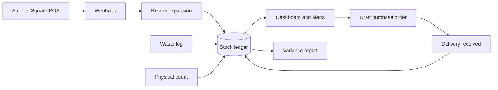
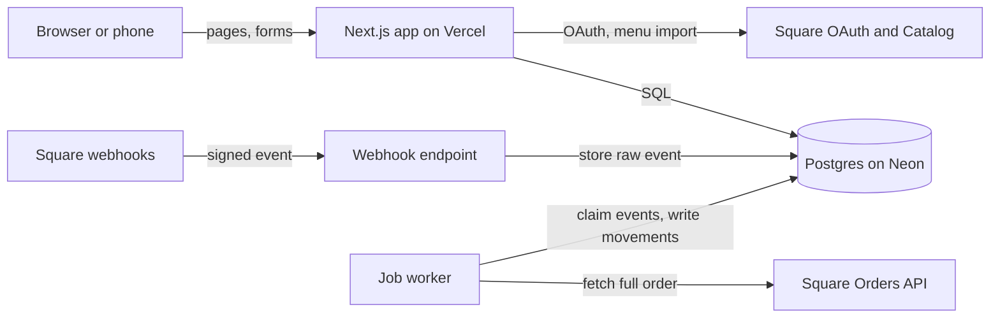
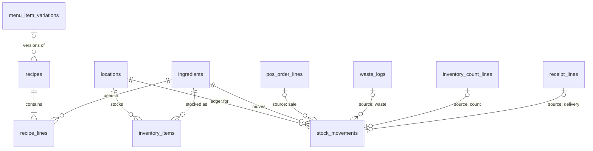

# Prompt: Build a Slide Deck for the ParLevel Project Update

## Your task

Make a slide deck that presents **ParLevel**, my BYU CS 452 (Database Modeling Concepts) final project. The deck should explain **what we are building and why**, **how it's designed** (especially the database), and **what we've done so far vs. what's next**.

- **Audience:** classmates and the instructor in a database modeling class. They know SQL, ERDs, foreign keys and indexes, but they know nothing about restaurants or this project.
- **Length:** about **12 slides**, for a talk of about **8 minutes**.
- **For each slide, give me:** a title, the on-slide content, a visual (diagram, image or layout idea), and **speaker notes** (3–5 sentences, conversational).
- **Use only the facts below.** Don't invent numbers, users, results or features. Example figures (like "$610 in chicken") must be presented as *example* or *illustrative* data, because there are no real customers yet.
- **Be honest about status.** We're at the **end of the planning phase**: no application code is written yet. Don't present stretch goals as committed or anything as already built.
- If you're unsure about something, add a short `[CHECK: …]` note on that slide instead of guessing.

Project repo (public): https://github.com/trevorwattles/DatabaseProject
Full proposal: https://github.com/trevorwattles/DatabaseProject/blob/main/docs/PROPOSAL.md

---

## Source material

### The one-liner

> Connect your Square POS, map your recipes once, and ParLevel tracks every ingredient automatically, tells you exactly where money is leaking, and drafts your supplier orders for you.

### The problem

Independent restaurants, cafés and small franchise owners (1–5 locations) track inventory with paper count sheets, spreadsheets, or a manager eyeballing the walk-in cooler. As a result they:

- **Run out** of key ingredients mid-shift, which costs them sales
- **Over-order**, so food spoils and money is wasted
- **Can't see where money leaks**: waste, over-portioning, theft
- **Lose hours every week** to manual counts and building supplier orders

Tools like MarketMan, MarginEdge, Restaurant365 and xtraCHEF exist, but they are often too expensive, too complex to set up, or built for larger operations.

### How it works (core loop)

1. **Connect POS.** The owner connects Square (OAuth), and the menu imports automatically.
2. **Map recipes.** For example, "Cheeseburger" = 1 bun + 4 oz beef + 1 slice cheddar + 0.5 oz sauce. Modifiers adjust usage ("extra cheese" = +1 slice). Prep items like sauces expand down to raw ingredients.
3. **Sales deplete inventory automatically.** Square sends a webhook for each completed order. Each line is expanded through its recipe into **sale** movements in a stock ledger.
4. **Deliveries add stock** along with the real unit cost.
5. **Waste logging.** Staff log waste from a phone in a few taps.
6. **Physical counts fix drift.** Counted vs. expected becomes an adjustment, and a line in the **variance report**.
7. **Reorder automatically.** Low stock (counting what's already on order) produces a draft purchase order grouped by supplier.

**Headline feature: the variance report.** It answers "how much money did I lose, and on what?" Example output (illustrative): *"Chicken is $610 short that sales and waste don't explain."*

Flow diagram (Mermaid source you can redraw):



### Target user & positioning

- **Customer:** independent quick-service restaurants, cafés and small franchise owners with **1–5 locations** using **Square POS**, starting in **Utah County**
- **Differentiation:** setup in under an hour (menu import + recipe templates), mobile-first counting, plain-English dollar insights
- **Go-to-market:** visit local shops, pilot with 1–3 friendly owners, then franchise networks and the Square App Marketplace
- **Expansion:** Clover → Toast → multi-location → supplier integrations → AI forecasting

| | Built for | Setup effort | Small-shop fit |
|---|---|---|---|
| Spreadsheets / paper | Anyone | Low | Free but manual, no insight |
| MarketMan | Mid-size, multi-unit | High | Powerful but heavy |
| MarginEdge | Mid-size, invoice-focused | Medium | Strong on invoices |
| Restaurant365 | Multi-unit groups | Very high | Overkill for 1–5 locations |
| xtraCHEF (Toast) | Toast restaurants | Medium | Tied to Toast |
| **ParLevel** | **1–5 location Square shops** | **Low (< 1 hr)** | **Simple, mobile-first** |

### Tech stack

| Layer | Choice |
|---|---|
| Frontend | Next.js (App Router), TypeScript, Tailwind CSS, shadcn/ui, phone-friendly PWA |
| Backend | Next.js route handlers + server actions (one deployable app) |
| Database | **PostgreSQL on Neon** + **Drizzle ORM** with versioned SQL migrations |
| Auth | Auth.js with Google sign-in, sessions stored in Postgres |
| POS | Square sandbox: OAuth, Catalog API, Orders API, webhooks |
| Background jobs | `webhook_events` table as a queue (`FOR UPDATE SKIP LOCKED`) + Vercel Cron |
| Testing | Vitest against a Neon database branch |
| Hosting | Vercel + Neon |
| Stretch | Claude API (invoice photo scanning, natural-language questions), Resend (email POs) |

System design (Mermaid source you can redraw):



### The database design (the most important part for this class)

**Size:** about **35 tables** in three areas:

1. **Tenancy, auth, units & suppliers:** organizations, locations, users, memberships (roles), Auth.js accounts/sessions, POS connection, units, unit conversions, ingredients, inventory items (per location), suppliers, supplier items
2. **Menu, recipes & raw POS data:** menu items and variations, versioned recipes and recipe lines, modifiers and modifier recipe lines, webhook events, POS orders / lines / line modifiers, refunds, unmapped POS items
3. **Stock ledger & operations:** stock movements, waste logs, inventory counts and count lines, purchase orders and lines, receipts and receipt lines, invoices and invoice lines (stretch)

**Key design ideas.** Each of these is worth a short explanation; pick the 4–5 strongest for the slides.

1. **A ledger, not a counter.** Inventory is an **append-only `stock_movements` table** (sale, delivery, waste, count adjustment, opening balance, void). On-hand = `SUM(qty_delta)`. A trigger **rejects UPDATE and DELETE**. Mistakes are fixed with a `void` movement plus a new correct entry, like accounting. A cached `on_hand` column is updated in the same transaction for fast reads. This audit trail is what makes the variance report possible.
2. **Exclusive arc for movement sources.** Each movement has one real foreign key column per source type (order line, waste log, count line, receipt line, voided movement), plus `CHECK (num_nonnulls(...) = 1)`. This replaces an untyped polymorphic `source_type` + `source_id`, so referential integrity is real.
3. **Idempotency through constraints.** Square webhooks arrive *at least once* and sometimes out of order. `webhook_events.event_id` is UNIQUE, and each movement source has its own unique index (e.g. `(pos_order_line_id, ingredient_id)`). So a replayed webhook, a resubmitted count or a double-tapped "Receive" button **can never double-count**. The database guarantees it, not app code.
4. **Base units + `NUMERIC`.** Every quantity is stored in the ingredient's base unit (oz, each, ml) as `NUMERIC`, never float. Unit conversion tables handle lb → oz and ingredient-specific ones like "1 case of buns = 96 each."
5. **Raw vs. derived data + versioned recipes.** Square data is stored exactly as received, and stock movements are derived from it. Recipes have `effective_from` / `effective_to`, with a Postgres **exclusion constraint** that prevents overlapping versions, so any past sale can be re-derived with the recipe in effect at the time.
6. **Multi-tenant safety.** Every business row has `organization_id`, and foreign keys between tenant tables are **composite** `(organization_id, id)`, so the database makes cross-organization references impossible.
7. **Weighted average cost.** Every movement stores `unit_cost`, so old dollar figures stay stable. Deliveries update average cost, which resets to the delivery cost if on-hand was ≤ 0.

**Variance report math** (good for one slide):

| Column | Meaning |
|---|---|
| Expected | Starting on-hand + deliveries − sales usage − logged waste |
| Counted | What the manager counted |
| **Unexplained variance** | Counted − expected, in units and dollars |

A simplified ERD core you can draw (the full ERD is in the proposal):



### UX sketches (already done)

Six low-fidelity grayscale wireframes exist. You can embed them directly from these URLs:

| Screen | Image URL |
|---|---|
| Dashboard | https://raw.githubusercontent.com/trevorwattles/DatabaseProject/main/docs/ux/dashboard.svg |
| Recipe mapping | https://raw.githubusercontent.com/trevorwattles/DatabaseProject/main/docs/ux/recipe-mapping.svg |
| Count (mobile) | https://raw.githubusercontent.com/trevorwattles/DatabaseProject/main/docs/ux/count-mobile.svg |
| Waste log (mobile) | https://raw.githubusercontent.com/trevorwattles/DatabaseProject/main/docs/ux/waste-mobile.svg |
| Variance report | https://raw.githubusercontent.com/trevorwattles/DatabaseProject/main/docs/ux/variance-report.svg |
| Purchase order | https://raw.githubusercontent.com/trevorwattles/DatabaseProject/main/docs/ux/purchase-order.svg |

If you can't embed images, describe each one in a placeholder box so I can drop it in.

### What's done so far (status as of Nov 23, 2026)

**Planning phase: complete.** No application code is written yet.

- Public GitHub repo with project log, README, and a `CLAUDE.md` that gives AI coding sessions the project rules
- **Full proposal**: problem, goals, business case, competition, risks
- **ERD** with about 35 tables, plus written constraints and indexes (uniques, CHECKs, exclusion constraint, partial indexes)
- **System design diagram** and **3 sequence diagrams**: order webhook → inventory depletion, physical count → variance, low stock → draft PO → receive
- **6 UX wireframes**
- **Day-by-day schedule** from Nov 19 to Dec 10 (37.5 planned hours)
- **A plan review** that tightened the design and recorded **23 decisions**. Examples:
  - The first count is an **opening count**, excluded from variance, so the first report doesn't show the whole stock as "found"
  - **Refunds don't restock**, because the food was already made
  - Mistakes are fixed with **void movements**, never edits
  - Sub-recipes **expand to raw ingredients** at sale time
- **Hours logged:** 2.25 of a 30–40 hour target
- **AI-assisted development:** Claude Code helped draft the planning docs and diagrams, and the plan was then reviewed and refined

### What's next (MVP, by Thu Dec 10, 2026)

1. Scaffold Next.js + Neon + Drizzle; schema v1 and migrations
2. Google sign-in, organization/location setup, roles
3. Square sandbox OAuth + menu import; webhook endpoint with signature check
4. Job worker: fetch orders, process them idempotently into sale movements
5. Ingredient, unit and supplier screens; versioned recipe mapping UI
6. Inventory dashboard (on-hand, low stock, unmapped items)
7. Mobile waste logging; opening count + physical count; **variance report**
8. Auto-drafted purchase orders + receiving deliveries
9. Sales simulator and seed data for the demo; ledger tests (webhook replay, double submit, voids)

**Stretch (only if ahead):** AI invoice photo scanning, emailing POs, natural-language questions, usage forecasting, multi-location, prep batches, Row-Level Security.

**Schedule highlights:** risky parts (Square OAuth, webhooks, schema) first; rest days on Sundays and Thanksgiving; buffer days Dec 7–8; presentation Dec 10.

**Key risks:** POS API access (Square is open, Toast is gated); messy recipe data; owner trust with sales data; fitting the MVP into 30–40 hours.

---

## Suggested slide outline

Adjust if you see a better flow, but keep the emphasis on the database design.

1. **Title.** ParLevel: POS-driven inventory for small restaurants. Subtitle: CS 452 final project, planning update. `[CHECK: presenter name(s)]`
2. **The problem.** Four pain points, each with an icon. One line on why existing tools don't fit small shops.
3. **The solution in one picture.** The core-loop flow diagram.
4. **The headline feature: variance report.** The variance report wireframe, the illustrative "$610 in chicken" example (labeled as example data), and the expected − counted math.
5. **Who it's for.** Target customer and a compact competition table.
6. **Architecture.** The system design diagram and the tech stack.
7. **Database overview.** The three areas, ~35 tables, and the simplified ERD core.
8. **Design idea: the ledger.** Append-only, trigger-enforced, voids instead of edits, on-hand = SUM.
9. **Design idea: integrity through constraints.** Exclusive arc, unique indexes for idempotency, composite tenant FKs, versioned recipes with an exclusion constraint, NUMERIC base units. Show 1–2 short SQL snippets.
10. **What it will look like.** Mobile count + waste wireframes side by side, plus a dashboard thumbnail.
11. **What's done so far.** Checklist of completed planning work and hours logged.
12. **What's next.** A timeline from now to Dec 10, MVP vs stretch, and key risks.
13. *(Optional)* **Questions.** Repo link.

## Style

- Clean and modern, with plenty of white space. Use a neutral or grayscale base with **one accent color** (a warm green or deep teal suits food and money).
- At most ~5 bullets per slide and short phrases, not sentences. Detail goes in the speaker notes.
- Diagrams beat text. Redraw the Mermaid diagrams as clean visuals and keep labels short.
- Code and SQL in a monospace font, at most ~6 lines per snippet. Example snippet for slide 9:

```sql
CHECK (num_nonnulls(pos_order_line_id, waste_log_id,
       inventory_count_line_id, receipt_line_id,
       voids_movement_id) = 1)

CREATE UNIQUE INDEX ON stock_movements (pos_order_line_id, ingredient_id);
```
